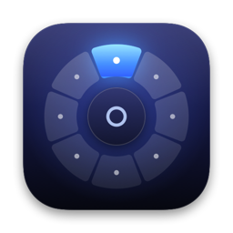
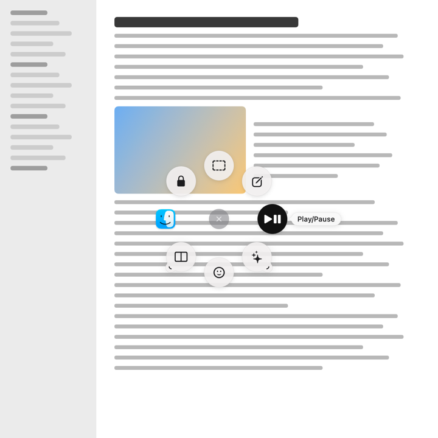
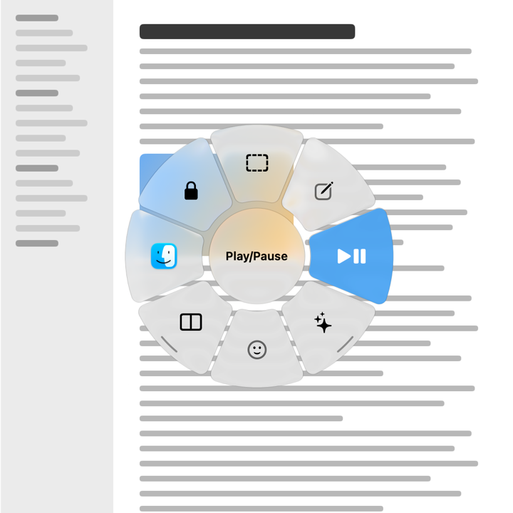
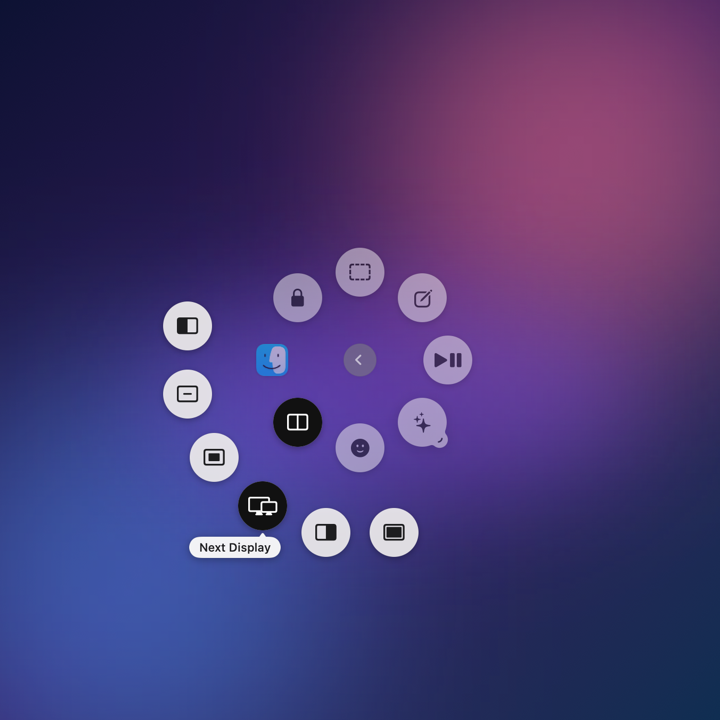
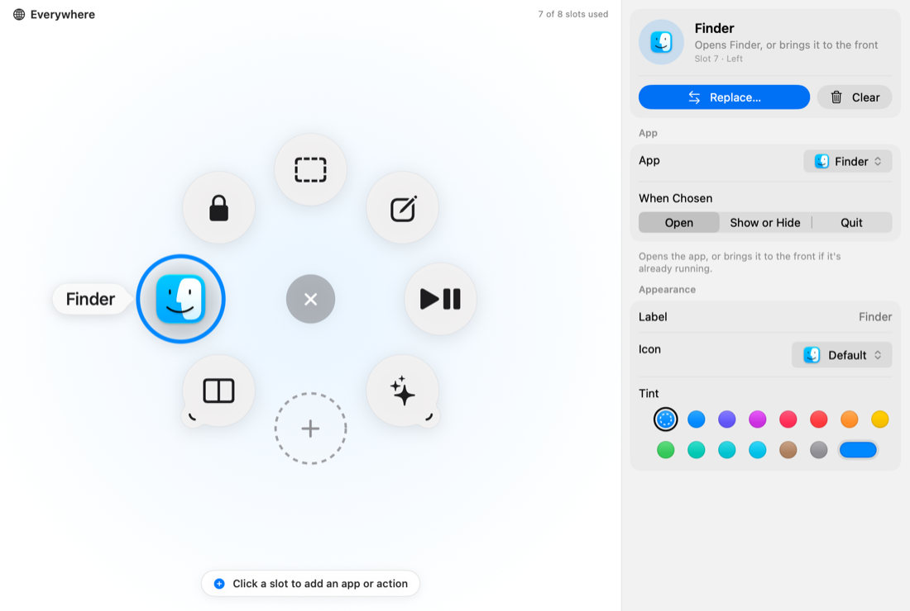
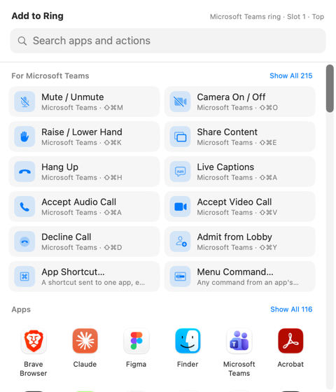

<p align="center">
  
</p>

<h1 align="center">Halo</h1>

<p align="center">
  Your favourite actions in a ring around the pointer, one shortcut away.<br>
  Free and open source, for macOS and Windows.
</p>

<p align="center">
  
  
</p>

Press a shortcut (or a mouse button you map to it) and Halo opens a ring of actions around your
pointer: open an app, take a screenshot, play or pause music, mute a call, move a window, paste
a snippet, ask an AI about the text you selected. Point and click, or hold, flick toward an
action and let go. Each app can have its own ring, and rings can hold folders of more actions.

Halo is inspired by Logitech's Actions Ring, but it works with any mouse or keyboard, needs no
account and sends nothing anywhere. It is not affiliated with Logitech.

## Contents

- [Install](#install)
- [First steps](#first-steps)
- [Using the ring](#using-the-ring)
- [Customising](#customising)
- [What a slot can do](#what-a-slot-can-do)
- [Updates](#updates)
- [Privacy and permissions](#privacy-and-permissions)
- [Troubleshooting](#troubleshooting)
- [Building from source](#building-from-source)
- [Publishing a release](#publishing-a-release)
- [License](#license)

## Install

Download the latest version from **[Releases](https://github.com/srinidhibhat45/Halo/releases/latest)**.

### macOS (26 Tahoe or later)

1. Download `Halo-<version>-mac.dmg` and open it.
2. Drag **Halo** onto **Applications**.
3. Open Halo from Applications.

Halo isn't notarised by Apple yet, so the first time macOS may say it "can't be opened". Open
**System Settings › Privacy & Security**, scroll down and click **Open Anyway** next to Halo.
You only do this once.

### Windows (10 and 11)

1. Download `HaloSetup.exe` and run it. Halo installs for your user account, no admin rights needed.
2. Halo starts and its icon appears in the notification area (next to the clock).

Halo isn't code-signed for Windows yet, so SmartScreen may warn you. Click **More info › Run anyway**.

## First steps

A short welcome guide opens the first time. It walks you through:

1. **Your shortcut.** The default is **⌃⇧⌘H** on Mac (Control-Shift-Command-H) and
   **Ctrl+Shift+Alt+H** on Windows. Record any other combination you like.
2. **A mouse button (optional).** In your mouse's software, assign a button to send that
   shortcut:
   - *Logi Options+*: select the button › **Keyboard shortcut** › press the shortcut.
   - *BetterTouchTool, SteerMouse, Razer Synapse, G HUB…*: assign a keyboard shortcut action.
   The guide's **Test Your Trigger** tells you whether your software holds the key while the button
   is down (then hold-and-release works) or sends a quick tap (then tap-then-click works).
3. **Permissions (macOS).** Halo asks for **Accessibility**, which it needs to press keys, control
   media and windows, and read selected text. Opening apps and links works without it.
4. **Try it.** Press the shortcut anywhere.

## Using the ring

| To | Do this |
|---|---|
| Open the ring | Press your shortcut (or mouse button) |
| Choose an action | **Tap**, then click a slot, or **hold**, flick toward a slot and let go |
| Choose by keyboard | Press **1–9** or **0**, or use the arrow keys / Tab and **Return** |
| Open a folder | Rest the pointer on it for a moment (or click it); its actions fan out |
| Go back / close | Click the centre, press **Esc**, or click anywhere outside |
| Adjust volume or brightness | Point at a volume or brightness slot and scroll |
| Edit a slot | **⌘-click** it (Mac) or **Ctrl-click** it (Windows) |

Pressing the shortcut again while the ring is open runs the highlighted action, or closes the ring.

<p align="center"></p>

## Customising

Open **Halo Settings** from the menu bar icon (Mac) or the tray icon (Windows).

<p align="center"></p>

- **Add an app or action:** click an empty slot. Pick an app from the grid or anything from the
  labelled list; one click fills the slot. Click a filled slot to change or clear it.
- **Rearrange:** drag a slot onto another to swap them.
- **App rings:** **Add App Ring…** gives an app its own ring, used while that app is in front.
  Empty slots can borrow actions from your main (Everywhere) ring.
- **Folders:** add a **Nested Ring** to put more actions behind one slot.
- **Looks:** in **Appearance**, choose **Classic** (light bubbles) or **Glass** (Liquid Glass), the
  size, labels, slot numbers, accent colour and animation speed. **Close up empty slots** (on by
  default) shows only your actions, evenly spaced.
- **Undo:** every change can be undone with ⌘Z / Ctrl+Z.
- **Back up or move your setup:** **General › Export…** saves your rings to a file; **Import…**
  loads them on another computer.

## What a slot can do

| Kind | Examples |
|---|---|
| Apps | Open, switch to, show/hide or quit an app |
| In-app actions | An app's own shortcuts, such as **Teams: Mute** or **Zoom: Raise Hand**, sent to that app even from another one; any command from an app's menu bar (Mac); buttons clicked in order for things without a shortcut, such as **Teams: Start Recording** (Mac) |
| Websites, files and folders | Open a page, a deep link, a document or a folder |
| Media | Play/pause, next, previous, volume, mute, brightness |
| Screenshots | Area, window or screen, to a file or the clipboard; the screenshot toolbar |
| System | Mission Control / Task View, Show Desktop, Lock, Sleep, Emoji, Spotlight / Search, Dark Mode… |
| Edit and windows | Copy, paste, undo; snap a window left or right, fill, centre, next display |
| Keyboard shortcuts | Any key combination, sent to the app in front |
| Automation | Apple Shortcuts and AppleScript (Mac), shell or PowerShell commands |
| Text | Snippets with {date}, {time}, {clipboard} and {selection} placeholders |
| AI prompts | Send the selected text with your prompt to Claude, ChatGPT, Perplexity or Gemini |
| Smart Actions | Several actions in a row, with pauses between them |

**In-app actions.** Halo knows the documented shortcuts of popular apps: Microsoft Teams, Zoom, Google
Meet, Slack, Webex, Discord, Outlook, Word, Excel, PowerPoint, Keynote, Notion, Figma, Photoshop,
Lightroom, Premiere Pro, Final Cut Pro, DaVinci Resolve, VS Code, Xcode, Chrome, Safari, Arc, Edge,
Spotify, Music, Finder, Mail and Notes. Give an app its own ring and its actions are listed first;
meeting controls such as **Mute**, **Camera** and **Raise Hand** can bring the app forward, act, and
return you to what you were doing. Where an app has no shortcut for something (Teams' **Start
Recording** and **Start Transcription**), Halo clicks the app's own buttons for you; add your own
with **Click Buttons…** and **Add by Pointing**. Some apps need a setting first (Zoom's shortcuts work from other
apps only when marked "global" in Zoom); the full list, with sources and Windows keys, is in
[docs/app-actions.json](docs/app-actions.json).

<p align="center"></p>

## Updates

Halo updates itself from this repository's
[Releases](https://github.com/srinidhibhat45/Halo/releases). It checks shortly after it starts and
then once a day, and asks before installing. On a Mac you can also choose **Check for Updates…**
from the menu bar icon; on Windows, from the tray icon. Turn automatic checks off in **About**.

The macOS updater only installs a download whose checksum matches the one published with the
release and whose app identity matches Halo.

## Privacy and permissions

- Halo has no account, no analytics and no telemetry. Your rings are stored in a readable JSON
  file: `~/Library/Application Support/Halo/config.json` on Mac, `%APPDATA%\Halo\config.json`
  on Windows.
- The only network request Halo makes on its own is the update check to GitHub. Actions you set up
  yourself (opening a website, an AI prompt) of course open what you asked for.
- macOS permissions:
  - **Accessibility** (needed): pressing keys, media keys, window layouts, reading selected text.
  - **Automation** (asked only if you use AppleScript or the Dark Mode switch).
  - Halo never needs Screen Recording: screenshots use your Mac's own screenshot shortcuts.

## Troubleshooting

**The ring doesn't appear.** Another app may already use the shortcut: open **Settings › General**,
which shows whether the shortcut is active, and record a different one. Also check that Halo isn't
paused (menu bar or tray icon).

**macOS says Halo doesn't have Accessibility, but it's switched on.** macOS sometimes keeps an
entry for an older copy of Halo. Open **Halo Settings › Permissions** and click **Fix Access…**,
then switch Halo on once more when macOS asks. From the source folder, `make reset-permissions`
does the same.

**My mouse button opens the ring but releasing doesn't choose.** Your mouse software sends a quick
tap rather than holding the key. Use tap-then-click, or set **General › Selection** to
**Tap, Then Click**.

**Windows: an action doesn't work in an app running as administrator.** Windows doesn't let
normal apps send keys to administrator apps. Run Halo as administrator too, or avoid that app.

## Building from source

### macOS

Needs macOS 26+ and Apple's Command Line Tools (`xcode-select --install`); Xcode isn't required.

```bash
cd macos
make install     # build Halo.app and install it in ~/Applications
make test        # run the unit tests
make run         # build and launch without installing
```

`Halo --render-snapshots <folder>` and `Halo --render-ui <folder>` render the ring and the
settings screens to PNG files, which helps when changing the design.

### Windows

Needs the .NET 10 SDK. The core library and its tests build anywhere; the app builds on Windows (or
anywhere with `-p:EnableWindowsTargeting=true`, though it only runs on Windows).

```bash
cd windows
dotnet test tests/Halo.Core.Tests
dotnet build Halo.Windows.sln -c Release
```

`windows/build/pack.ps1` produces `HaloSetup.exe` with [Velopack](https://velopack.io). See
[windows/README.md](windows/README.md) and [windows/ARCHITECTURE.md](windows/ARCHITECTURE.md).

### Layout

```
macos/     The Mac app: Swift package (HaloCore library + Halo app), build and release scripts
windows/   The Windows app: .NET solution (Halo.Core library + WPF app), tests, packaging
docs/      Product spec, release notes, images
VERSION    The version of both apps
```

## Publishing a release

1. Set the new version in `VERSION` and write `docs/release-notes/<version>.md`.
2. Build the macOS files: `cd macos && make release` (a universal DMG, the update zip and checksums
   in `macos/dist/`).
3. Publish: `make publish`. This creates the GitHub release with the macOS files after asking you
   to confirm.
4. GitHub Actions then builds the Windows installer and update files and adds them to the same
   release. Installed copies on both platforms offer the update within a day.

## License

Halo is free software under the [GNU General Public License v3.0](LICENSE). You may use, study,
share and change it; if you share a changed version, it must stay under the GPL too.

"Logitech" and "Actions Ring" are trademarks of Logitech; Halo is an independent project.
